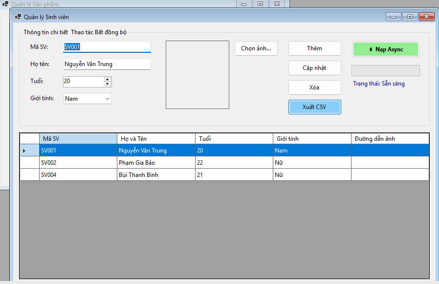
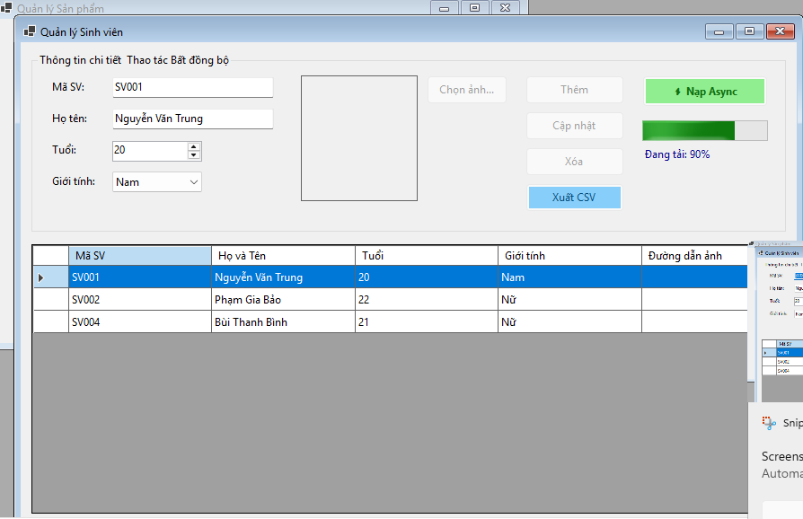
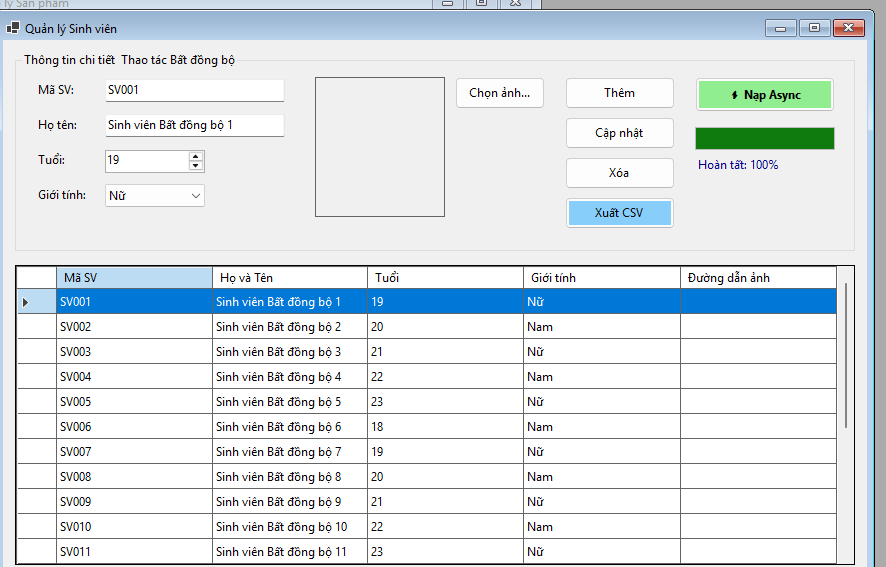

## THÔNG TIN SINH VIÊN
- **Họ và tên:** Bùi THanh Bình
- **Mã số sinh viên:** 24810320641
- **Lớp:** D19QTANM1
- **Tên môn học:** Lập trình.Net
- **Tên bài tập:** 4.8

---

## KẾT QUẢ THỰC HÀNH

### 1. Ảnh màn hình Giao diện chính

### 2. Ảnh màn hình Chức năng thực thi / Kết quả

### 3. Ảnh màn hình Kiểm tra lỗi (Validation)

